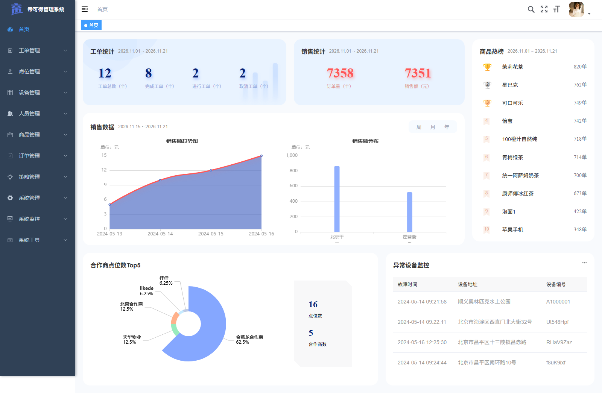
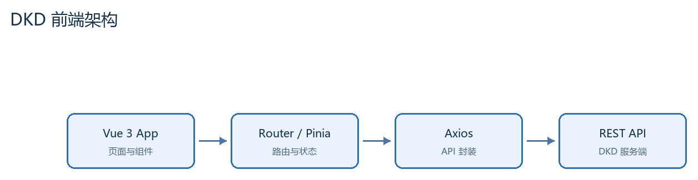

# 帝可得后台管理系统（前端）

基于 RuoYi-Vue 3.8.7 前端脚手架开发的“帝可得”后台管理系统前端，提供商品、货道、工单、订单、策略和设备等管理页面。

## 系统界面

后台首页展示工单统计、销售统计、商品热榜、销售趋势和异常设备监控等业务数据。

## 系统架构

前端采用 Vue 3 + Vite，路由和状态由 Vue Router / Pinia 管理，Axios 统一封装后端 REST API。

## 项目概览

| 项目信息 | 内容 |
| --- | --- |
| 前端框架 | Vue 3 + Vite |
| UI 组件 | Element Plus |
| 状态管理 | Pinia |
| 路由 | Vue Router |
| 权限体系 | RuoYi 菜单与角色权限 |
| 后端仓库 | RuoYi-dkd-server |

## 功能页面

- 登录与权限菜单
- 商品管理、货道管理
- 工单管理、订单管理
- 策略管理、设备管理
- 系统管理（用户、角色、菜单、日志）

## 技术栈

- Vue 3、Vite
- Element Plus、Vue Router、Pinia
- Axios、ECharts
- RuoYi-Vue 3.8.7

## 环境要求

- Node.js 18+
- npm 或 pnpm

## 安装与启动

~~~bash
git clone https://github.com/Smasun0721/RuoYi-dkd-client.git
cd RuoYi-dkd-client
npm install
npm run dev
~~~

开发环境默认通过 VITE_APP_BASE_API=/dev-api 代理到后端，后端地址见 .env.development 和 vite.config.js。

## 目录结构

~~~text
RuoYi-dkd-client/
├── src/
│   ├── api/
│   ├── assets/
│   ├── components/
│   ├── layout/
│   ├── router/
│   ├── store/
│   └── views/
├── public/
├── vite/
├── package.json
├── pnpm-lock.yaml
└── vite.config.js
~~~

## 关联仓库

- 服务端：[RuoYi-dkd-server](https://github.com/Smasun0721/RuoYi-dkd-server)

## 说明

本项目基于 RuoYi-Vue 3.8.7 前端脚手架二次开发，保留原框架的权限、菜单和基础组件，并实现帝可得业务页面。默认登录账号和密码由后端数据库初始化脚本提供，请以实际部署配置为准。
